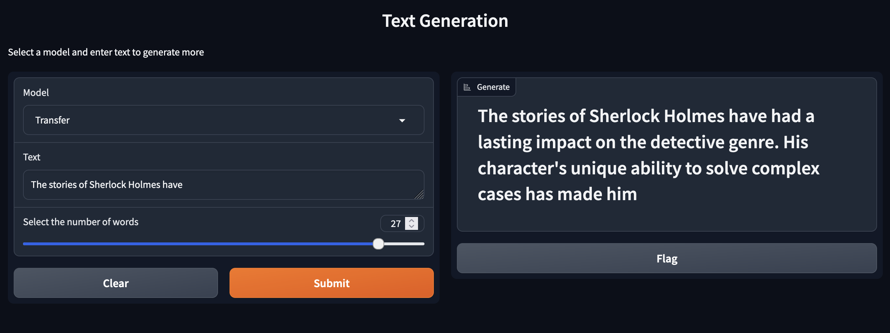

# Small Scale LLMs

The goal is to create small-scale language models from scratch using custom datasets, and also leverage Hugging Face's GPT-Neo model through transfer learning to fine-tune on specific data.

## Knowledge

```
Let’s say the model is given the sentence: "The cat sat on the mat."
```

1. Tokenization: 
    The sentence is tokenized into: ["The", "cat", "sat", "on", "the", "mat", "."]

2. Embedding:
    Each token is transformed into a vector representation (based on learned parameters). For example:
        "The" → [0.1, 0.3, -0.5, ...] (an embedding vector of numbers)
        "cat" → [0.2, -0.1, 0.4, ...]

3. Model Processing:
    The model's parameters are used to process these embeddings through layers like attention and feedforward networks. The parameters adjust how the model interprets the sentence, understanding that "cat" is an animal and "mat" is an object.

4. Output:
    The model might predict the next word based on the context or classify the sentence (e.g., is it positive or negative?). This prediction is guided by the weights (parameters) the model has learned during training.


**What is means by GPT Neo (125M) ?**

1. Tokens: These are the actual input units (words, subwords, or symbols) fed into the model.
2. Parameters: These are the learned weights inside the model that determine how the input tokens are processed and understood. They adjust the mathematical transformations applied to the tokens, but they are not the tokens themselves.

By 125M, we are pointing on 125 millions parameters

## Results:



